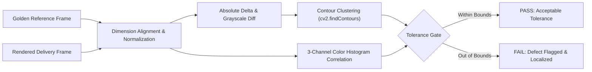

# vision-qa-lab 👁️

> **Computer Vision experiments in automated quality assurance: exploring layout anomaly detection, color calibration shifts, and structural artifact inspection using OpenCV, NumPy, and Python.**

[](https://www.python.org/)
[](https://opencv.org/)
[](https://numpy.org/)
[](https://fastapi.tiangolo.com/)
[](https://opensource.org/licenses/MIT)

---

## 💡 Why I Built This (Learning & Motivation)

In commercial media rendering, 3D graphics delivery, and automated digital publishing, manual visual quality inspection is slow and prone to human fatigue. 

Minor color channel drifts, font rendering glitches, and clipping artifacts can slip into client deliveries.

I built **`vision-qa-lab`** to explore how computer vision techniques can automate visual QA:
- **Structural Difference & Absolute Delta:** Pinpointing exact pixel-level anomalies using `cv2.absdiff` and adaptive thresholding.
- **Histogram Correlation:** Measuring color balance shifts across RGB channels using `cv2.compareHist` to detect printer/monitor calibration drift.
- **Contour Clustering:** Isolating and counting distinct defect clusters on high-resolution canvases.

---

## 🏛️ Pipeline Flow



---

## 🔬 Benchmark Results

Running automated visual regression tests on 300x300 canvas benchmarks:
- **Identical Frames:** MSE = `0.0`, Correlation = `1.0000`, 0 Contours detected.
- **Simulated Text Blurring / Artifacts:** Instantly flagged with bounding box coordinates and an error score proportional to distortion magnitude.

---

## 🧪 Quickstart

```bash
# 1. Clone repository
git clone https://github.com/monkey9-Cyber-cat-Spidy/vision-qa-lab.git
cd vision-qa-lab

# 2. Setup virtual environment
python -m venv venv
venv\Scripts\activate

# 3. Install dependencies
pip install -r requirements.txt

# 4. Run tests
pytest tests/

# 5. Start demo server
uvicorn app.main:app --reload --port 8000
```

---

## 👤 Author
**Kuncham Venkata Satya Manikanta**  
- **Portfolio:** [ai-engineer-eta.vercel.app](https://ai-engineer-eta.vercel.app/)  
- **GitHub:** [@monkey9-Cyber-cat-Spidy](https://github.com/monkey9-Cyber-cat-Spidy)  
- **LinkedIn:** [kvsmanikanta](https://www.linkedin.com/in/kuncham-venkata-satya-manikanta-9715a4321/)
